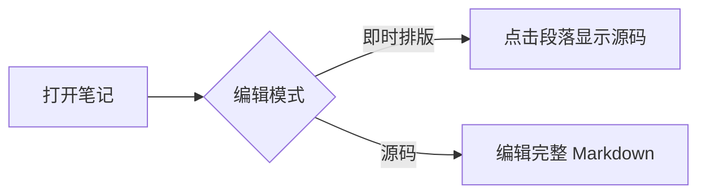
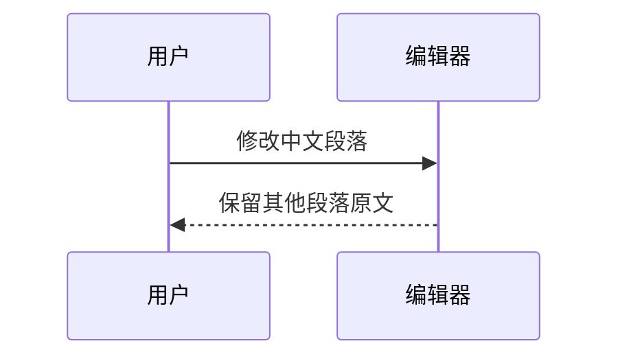

# 鸢笺编辑器验收

这个文件包含 **加粗**、*斜体*、~~删除线~~、`inlineCode` 和 [相对链接](同名笔记.md)。点击本段进入源码，编辑别处后本段里的两个  空格应保留。

## 清单与引用

- [ ] 点击任务复选框，应只改变这个方框中的一个字符
- [x] 已完成的任务
- 普通列表
  - 嵌套中文条目

> 这是引用。点击后可直接编辑原文。

## 表格网格

| 名称 | 数量 | 备注 |
| :--- | ---: | :---: |
| 中文单元格 | 3 | 点击编辑 |
| 转义符号 | 2 | a\|b |

## 代码与图表

```java
public class Hello {
    public static void main(String[] args) {
        System.out.println("你好，世界");
    }
}
```

```
const title = '尽力自动识别语言';
console.log(title);
```

```python
"""多行注释与行号
第二行依然高亮，不应增加空白行。
"""
print("不会执行这段代码")
```





## 数学

行内公式：$E=mc^2$，$\alpha+\beta=\gamma$。

$$
\sum_{i=1}^{n} i = \frac{n(n+1)}{2}
$$

在公式内键入 `frac`，按 Ctrl+Space 打开片段，Tab 接受并切换分子、分母；反斜线命令提供补全。

## 图片与链接

[[同名笔记#目标|Wiki 链接]]


## 原文安全

下面的内容应按文字显示，不能执行：

<script>alert('不能执行')</script>

[危险链接](javascript:alert(1))
